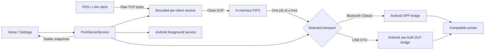

# PrintDock by Nexkit

A React Native Android app that receives raw TCP print jobs over a local network and forwards them to either a paired Bluetooth Classic thermal printer or a compatible printer connected directly to the phone through USB OTG. The phone acts as a receipt/POS printer bridge; clients supply printer-ready bytes.

**Pre-production.** Bounded queuing, lifecycle controls, automated tests, and Android build checks are implemented. Physical printer compatibility, background reliability, signing, and distribution are not certified. USB OTG is an unverified raw bulk-OUT transport, not a generic USB print driver. This app does **not** implement Apple's AirPrint protocol, IPP, or Bonjour discovery. iOS is experimental; the print service explicitly rejects non-Android platforms.

[Production plan](docs/production-readiness.md) · [UI & brand system](docs/design-system.md) · [Release guide](docs/releasing.md) · [Changelog](CHANGELOG.md) · [Repository](https://github.com/nathanpixodeo/air-print-app)

PrintDock is the new display brand. The existing repository URL, Android package `com.airprint`, React Native registration name `AirPrint`, and `airprint://` links are intentionally retained for compatibility. Updating the APK does not require clearing app data. Nexkit is the developer brand; its supplied logo is preserved unchanged.

## Capabilities and boundaries

| Area              | Implemented                                                                    | Boundary                                                                                               |
| ----------------- | ------------------------------------------------------------------------------ | ------------------------------------------------------------------------------------------------------ |
| Printer transport | Android Bluetooth Classic SPP and USB OTG raw bulk-OUT adapters                 | Pair Bluetooth in Android Settings; connect USB through OTG. No BLE, USB-serial, IPP, generic USB print-spooler, or certified printer matrix. |
| Network input     | Raw TCP, default port `9100`, bound to supplied local IPv4                     | Plaintext and unauthenticated. Controlled LAN only; no internet exposure.                              |
| Job handling      | Bounded receive buffers, FIFO single writer, 4 KiB native writes               | Memory-only jobs; no persistence, replay, client acknowledgement, or paper confirmation.               |
| Lifecycle         | Stopped, starting, listening, stopping, failed snapshots                       | Restart blocked while old native calls settle or cleanup fails.                                        |
| Background host   | Android connected-device foreground service                                    | OS/vendor restrictions, screen-off operation, and sustained reliability need hardware evidence.        |
| Operator UI       | Service snapshots, stable printer selection, port validation, safe-area layout | TalkBack, large text, contrast, and device flows still require manual acceptance.                      |
| Preferences       | Bluetooth printer ID, valid port, light/dark theme, Vietnamese/English/French in MMKV | USB device paths are ephemeral and are not persisted. No receipt data or credentials stored. English is the default/fallback. |
| External controls | Exact start/stop links with confirmation                                       | Not authenticated fleet management or unattended autostart.                                            |

The obsolete `react-native-bluetooth-serial` package and unused alternative printing transports were removed. This repository now owns the Bluetooth and USB native adapters and their device testing.

## Architecture and print contract



### Job boundary and delivery semantics

1. Connect to the bound IPv4/port and send the printer's complete command stream.
2. End the TCP connection normally. `react-native-tcp-socket` 6.x signals orderly EOF with non-error `close`, not Node's `end` event.
3. A nonempty job enters the FIFO. Receive errors, limit violations, timeouts, and queue overflow reject/discard affected work. Jobs are ordered by completed receive/admission, not connection arrival.
4. One writer sends up to 16 KiB per JS-to-native bridge call. The selected Android adapter writes the batch in ordered, bounded chunks, checking its active session around native I/O. USB uses bulk-OUT transfers and accounts for partial transfers. NUL/high bytes survive base64 encoding at the bridge boundary.
5. A write failure/timeout stops the service and discards waiting work. A receipt already being written has an **unknown physical outcome**. There is no automatic retry.

A connection left open does not print and eventually times out. Clean EOF is the only completeness marker: a logically truncated receipt closed normally cannot be detected. TCP acceptance is not job acceptance. A Bluetooth write or USB bulk-transfer completion is not paper confirmation. There is no application-level response or exactly-once guarantee.

The app does not render PDFs, HTML, images, or layouts. The sender supplies encoding, initialization, feeds, and cuts using the printer's documented byte protocol. ESC/POS is a possible supplied stream, not a built-in renderer.

### Enforced limits

Source: [printLimits.ts](src/services/printLimits.ts).

| Control                       | Default                             |
| ----------------------------- | ----------------------------------- |
| One job                       | 1 MiB                               |
| Receiving clients             | 4                                   |
| Receiving + waiting bytes     | 8 MiB                               |
| Waiting jobs                  | 20, also constrained by byte budget |
| Receive idle / total deadline | 10 / 60 seconds                     |
| Startup / cleanup deadline    | 15 / 5 seconds; USB startup allows 60 seconds for the system permission dialog |
| Entire job write deadline     | 30 seconds                          |
| JS-to-native write batch      | 16 KiB                              |
| Native write chunk            | 4 KiB                               |

This is not a total-process memory limit: the active job, temporary EOF copy, bridge encoding, native buffers, and framework add overhead. Defaults are engineering limits, not measured printer capacity. Changes need load and hardware testing.

The 16 KiB batch reduces bridge calls by up to fourfold versus a 4 KiB call per chunk. Connection checks run before and after each job rather than between every batch; each native adapter still guards its own active session. This is an app-side overhead reduction, **not a measured print-speed improvement**. Throughput and paper-output latency require representative physical printers for both transports.

### Ownership and recovery

- [PrintServerService](src/services/printServer.ts) validates endpoints, serializes lifecycle changes, publishes immutable snapshots, and coordinates native/background resources.
- [PrintPipeline](src/services/printPipeline.ts) owns client timers, buffers, queue admission, and sequential writes.
- [bluetoothSerial.ts](src/services/bluetoothSerial.ts) adapts binary writes and session-scoped disconnect events to [PrintBluetoothModule.kt](android/app/src/main/java/com/airprint/printing/PrintBluetoothModule.kt).
- [usbPrinter.ts](src/services/usbPrinter.ts) adapts device discovery, binary writes and session-scoped detach events to [UsbPrintModule.kt](android/app/src/main/java/com/airprint/printing/UsbPrintModule.kt). USB permission is requested by Android when connecting; USB discovery itself needs no Bluetooth permission.
- Bluetooth uses paired Classic SPP UUID `00001101-0000-1000-8000-00805F9B34FB`. USB enumerates attached printer-class or vendor-specific interfaces with a bulk-OUT endpoint, claims one interface, and sends raw bytes. Neither the USB class code nor an endpoint alone proves the device understands the sender's command stream. No payload logging or automatic retry.
- [Startup.tsx](src/screens/Startup/Startup.tsx) subscribes with `useSyncExternalStore`; navigation/theme changes do not own or restart the service.

Stop drops receiving/waiting work and closes TCP/selected-printer/background resources. Failed cleanup prevents restart; use **Stop** to retry. Unsettled native operations may require waiting or restarting the app after reconciling the receipt. App death loses all in-memory jobs. Force-stop/reboot recovery is not automatic.

## Development environment

| Component       | Pinned/configured baseline                                               |
| --------------- | ------------------------------------------------------------------------ |
| Node            | `22.23.3` in `.nvmrc`; engine `>=22.23.3 <23`                            |
| Package manager | Yarn Classic `1.22.22`; `yarn.lock` is canonical                         |
| Framework       | React Native `0.75.4`, React `18.3.1`, TypeScript `5.6.3`                |
| Android         | JDK 17, Gradle `8.8`, Kotlin `1.9.24`                                    |
| SDK             | Compile/target 34, minimum 23, build tools `34.0.0`, NDK `26.1.10909125` |
| Runtime         | Hermes on; New Architecture off                                          |

This baseline is **not** evidence of current store compliance. RN/SDK modernization and native page-size/ABI checks remain release work.

### Install and run

Use authorized SSH/Git credential-manager access to this private repository; never embed tokens in URLs.

```sh
git clone https://github.com/nathanpixodeo/air-print-app.git
cd air-print-app
# Select Node 22.23.3 with your Node version manager first.
corepack enable
corepack prepare yarn@1.22.22 --activate
yarn install --frozen-lockfile --non-interactive
```

Install the Android components above, configure `JAVA_HOME` and the SDK path (`ANDROID_HOME` or untracked `android/local.properties`), enable USB debugging, and check `adb devices`. Run in separate terminals:

```sh
yarn start
```

```sh
yarn android
```

This is React Native CLI, not Expo. Emulators test UI/build behavior but cannot certify Bluetooth or USB OTG printing. Do not regenerate `package-lock.json`, change lockfile format, or bypass install failures with `--force`.

For Genymotion, follow the [emulator smoke-test guide](docs/genymotion-testing.md), including ABI selection and the Metro/ADB connection.

The pinned postinstall hook applies the reviewed [background-service patch](patches/README.md): immutable package-scoped notification intents, connected-device service metadata, and safe null-intent handling. Do not skip install scripts or edit `node_modules` without updating the versioned patch.

### iOS investigation only

On macOS with Xcode, Ruby/Bundler, and CocoaPods:

```sh
bundle install
cd ios
bundle exec pod install
cd ..
yarn ios
```

Open `ios/AirPrint.xcworkspace`. Identity, deployment target, Pods, permission descriptions, and URL registration need review. The new SPP bridge is Android-only. A legitimate accessory/background model must be demonstrated before iOS support is promised; see [IOS-01](docs/production-readiness.md).

## Operator workflow

1. Connect Android and the sender to a trusted LAN; check routing/client isolation.
2. For Bluetooth, pair a compatible Classic SPP printer in Android Settings, enable Bluetooth, grant Nearby devices permission, then use **Find paired printers**. For USB, attach a printer through a USB OTG adapter, use **Find USB OTG printers**, select it, and grant the Android USB access dialog when starting. USB discovery does not require Bluetooth permission.
3. Select an integer port from `1024` to `65535` (default `9100`). Start and wait for **listening**. Reconnect and rescan USB after unplugging it; its device path is not saved across app starts.
4. Send a small non-sensitive fixture using the chosen printer's documented byte protocol and verify paper output. Stop when finished.

Example from a computer on that LAN; replace the address:

```sh
node -e 'const net = require("node:net"); const s = net.createConnection({host: "192.168.1.50", port: 9100}, () => s.end(Buffer.from("AirPrint test\n\n\n", "ascii"))); s.setTimeout(5000, () => s.destroy(new Error("TCP timeout"))); s.on("error", e => { console.error(e.message); process.exitCode = 1; });'
```

This quoting works in PowerShell or POSIX shells. Only use plain text if supported by the printer. Do not resubmit an uncertain receipt until an operator reconciles what printed.

### USB OTG compatibility boundary

This path is Android USB **host** mode: the printer plugs into the phone, not into the LAN or a PC. The app looks for an attached printer-class (`0x07`) or vendor-specific (`0xFF`) interface with a bulk-OUT endpoint and sends the sender's bytes directly. It does not negotiate a printer language, convert documents, install vendor drivers, implement USB serial/CDC, or use Android's generic print framework. A USB device appearing in the picker means only that an eligible interface exists; successful printing requires the exact model/firmware to accept the raw bytes and the phone/adapter to provide adequate host power. Some printers require a vendor protocol or initialization and will not work through this adapter.

To qualify a model, record printer make/model, firmware, USB VID:PID, interface/endpoint descriptors, phone/Android version, OTG adapter and power arrangement, and the documented command language. Test byte-exact fixtures, repeated jobs, disconnect during permission/printing, denial/regrant, paper-out, screen-off, and stop/restart on a physical phone. Genymotion and mocked tests cannot establish USB host or paper-output compatibility. Until this matrix passes, USB is an experimental transport rather than a supported-printer promise.

For a physical-phone development run, the retained arm64-oriented debug APK is `artifacts/genymotion/printdock-0.0.1-debug-arm64-usb-otg.apk` (SHA-256 `62852acbdc6a2ed0a9378c64d9b218a8244fb7d29ca7858ec7c6442b4ae78b94`). It requires Metro and is not a release candidate. Because the phone's USB port hosts the printer, ordinary USB-cable ADB and `adb reverse` may be unavailable during the print test: use Android wireless debugging and point the React Native development server at the computer's reachable LAN IP/port 8081, or use a verified hub/topology that supports the required roles and power. Confirm that the printer and phone stay attached and on the trusted LAN before sending a non-sensitive fixture. Do not install over a differently signed package without first resolving the signing/data-retention implications.

## Configuration and external links

| Setting        | Behavior                                                                                                                                        |
| -------------- | ----------------------------------------------------------------------------------------------------------------------------------------------- |
| Printer/port   | MMKV persists the Bluetooth printer ID and port; USB device paths are never persisted and must be selected after each app start or reattachment |
| Bind address   | Validated supplied IPv4; never wildcard `0.0.0.0`                                                                                               |
| Network change | Device IP checked every 30 seconds; changed addresses produce a warning. Bound endpoint/notification do not silently migrate: stop and restart. |
| Theme/language | Persisted; Vietnamese/English/French UI resources; native/service diagnostics remain English                                                    |
| Environment    | No backend or `.env` required by the active print path                                                                                          |

Only these exact lowercase URIs are accepted. Queries, fragments, other hosts/schemes, and extra paths are rejected:

| URI                            | Action                                                                          |
| ------------------------------ | ------------------------------------------------------------------------------- |
| `airprint://printserver/start` | Confirm start using selected/persisted valid configuration after initialization |
| `airprint://printserver/stop`  | Confirm stop/cleanup; also used by the service notification                     |

The initial URL is consumed once per JS process. Busy transitions ignore external controls; every caller still passes service validation.

```sh
adb shell am start -W -a android.intent.action.VIEW -d "airprint://printserver/stop" com.airprint
```

## Quality checks and evidence

```sh
yarn lint
yarn test:report --runInBand
```

`lint` runs ESLint, source/mock formatting, and strict `tsc --noEmit`. `test:report` produces coverage and JUnit output (`JEST_JUNIT_OUTPUT_DIR=coverage` in CI). README/docs are outside the source formatting glob.

[Mobile checks](.github/workflows/ci.yml) defines frozen installs, lint/types/tests, Android debug build/lint, and retained reports with read-only permissions and pinned actions. It does not sign releases, set branch protections, or prove a hosted run has passed.

See [dated implementation evidence](docs/production-readiness.md#implementation-status-2026-09-25). Mocked JS tests do not execute Kotlin or establish device/background safety. Coverage, native builds, signing, physical faults, soak, and pilot remain separate gates.

For development without a printer, [USB service tests](src/services/printServer.test.ts) use a **test-only simulated USB sink** to capture binary jobs, assert FIFO order, and inject bulk-write failure or detachment. [Adapter tests](src/services/usbPrinter.test.ts) verify base64 byte transfer and session-scoped events. This fixture is not a selectable printer in Home or an emulator USB device. Genymotion can verify the no-printer UI and USB discovery path, but it cannot prove USB host transfers or paper output.

## Security and operations

Anyone reaching the port can send arbitrary printer commands. Address binding and resource limits are not authentication, TLS, per-sender rate limiting, or protection against an untrusted client occupying queue capacity. Never port-forward the service. The owner must approve managed-LAN controls or an authenticated protocol/gateway before external beta.

Tracked signing values were removed; `.env` is ignored/untracked and its local copy retained. **History is not sanitized, and deleting current values does not resolve exposure.** The owner must inventory and rotate/reset any affected real credentials using the appropriate store process. Release Gradle tasks require external signing properties; see [signing preparation](docs/releasing.md#signing-and-build-preparation).

Do not share payloads, customer data, secrets, or printer identifiers in logs. Redacted structured diagnostic export/crash reporting is still planned. No durable spool, deduplication, or safe automatic replay exists.

## Troubleshooting

| Symptom                  | Action                                                                                                                                                                                                                                     |
| ------------------------ | ------------------------------------------------------------------------------------------------------------------------------------------------------------------------------------------------------------------------------------------ |
| Bluetooth printer missing | Pair in Android Settings, enable Bluetooth, allow nearby devices, refresh. BLE-only devices need another adapter.                                                                                                                         |
| USB printer missing       | Confirm host-mode OTG, cable, power, and physical connection; use the separate USB scan. The picker shows only printer/vendor interfaces with bulk OUT, not every USB printer.                                                             |
| USB permission denied     | Stop, reconnect/rescan if needed, start again, and approve Android's USB dialog. Bluetooth permission is not needed for USB scanning.                                                                                                     |
| Start fails              | Check printer, local IP, the selected transport's permission, port conflict, and displayed error. Success waits for printer connection and listener readiness.                                                                             |
| Port unreachable         | Check bound endpoint, LAN isolation/routing, firewall/VPN, and network changes.                                                                                                                                                            |
| TCP succeeds, no paper   | Close normally, inspect limits/service error, verify byte protocol, then reconcile output. TCP has no job acknowledgement.                                                                                                                 |
| Failed/cannot restart    | Press Stop to retry cleanup. Wait for unsettled native operations; reconcile unknown receipts before resubmitting after app restart.                                                                                                       |
| Notification absent      | On Android 13+, allow notifications. Denial alone does not prevent the service; Android may show it only in Task Manager.                                                                                                                  |
| Screen-off failure       | Record OS/device/printer and redacted logs. Vendor battery/background behavior still needs qualification.                                                                                                                                  |
| Build/install failure    | Verify pinned tools and frozen lockfile; inspect the first error. JS tests alone do not establish native release readiness.                                                                                                                |
| Genymotion will not boot | Verify the exact VM state, host RAM, and ADB before reinstalling. See the [dated emulator report](docs/genymotion-testing.md); repeated second-stage stalls remained unresolved on this host. Preserve the VM disk and installed app data. |

Reports should identify commit/version, phone/OS patch, printer/firmware, topology, exact steps, and a non-sensitive fixture. Review `adb logcat` before sharing.

## Repository map

```text
android/app/src/main/java/com/airprint/printing/  Owned SPP and USB OTG native modules
src/services/                                   Lifecycle, pipeline, limits, adapter, tests
src/screens/Startup/                            Controls, strict links, preferences
src/screens/Settings/                           Theme, language, package version
src/components/                                 UI, safe-screen, error components
src/theme/                                      Typed theme and appearance
src/translations/                               Vietnamese/English/French resources
__mocks__/                                      Test wrappers and native mocks
.github/                                       CI, metadata, release template
docs/                                          Production gates and release operations
ios/                                           Experimental native project
```

## Releases and licensing

Package, Android `versionName`, and Settings currently read `0.0.1`; Android `versionCode` is `1`. iOS retains historical identity/version settings and is not a release target. Check distribution history before assigning build numbers.

[Repository metadata](.github/repository-metadata.json) records description/topics. The [release template](.github/release-template.md) requires source SHA, build numbers, signer/artifact hashes, tested hardware, limits, validation, and rollout ownership. Follow [production gates](docs/production-readiness.md) before [annotated tagging](docs/releasing.md). No release tag is implied by this work.

No `LICENSE` file is tracked. The earlier MIT claim was not supported by a repository license grant; the owner must confirm licensing and third-party notices before distribution. This update assigns no copyright holder and grants no new license.
