# Production-readiness plan

Assessment date: 2026-09-24. Source baseline: `ebb5947c2c7682a299d9797ac9fadef4a96d66da` on `main`. Scope: the mobile TCP-to-printer bridge, native packaging, delivery process, and operational documentation. The original assessment covered Bluetooth; the USB OTG increment is recorded separately below.

**Release decision: no-go for production.** The original assessment and acceptance criteria are retained below; implemented improvements and actual verification are separated in the dated status record. Network trust, device/native compatibility, signing, and release evidence still block production.

The original assessment used source/configuration review and Git metadata only. The historical findings below remain as baseline evidence; the following implementation record supersedes statements about current code. Task owners are roles to assign, not named people who have accepted work.

## Repository and hosted-CI update (2026-09-26)

The PrintDock/USB OTG implementation was committed and pushed to `main` as `c1d80aa`; this was a source commit, not a release tag or signed candidate. GitHub About metadata is maintained from [repository-metadata.json](../.github/repository-metadata.json), including the USB OTG topic. The first [hosted CI run](https://github.com/nathanpixodeo/printdock/actions/runs/36229150907) passed its JavaScript install, lint, tests, and bundle job, but Android failed before compilation because `sdkmanager` was not on the runner's `PATH`. The workflow now invokes the SDK manager through `ANDROID_HOME`; a passing follow-up hosted Android run is still required. The subsequent full-identity rename changes the Android package to `com.nexkit.printdock`, the deep-link scheme to `printdock://`, and the experimental iOS project/bundle ID. A local renamed-identity Android debug build/lint, 91 Jest tests, TypeScript, ESLint, Prettier, and [Genymotion smoke test](genymotion-testing.md#full-identity-printdock-smoke-test-2026-09-26) passed; its APK SHA-256 is `29e4e1a169a45e847f4b209eba608731ed8d8ce0af7ab7ed0213fc1ddb94aadd`. It launched as the separate new app and rejected a deep-link start without a printer. This does not establish data migration, hardware printing, iOS build, or hosted Android CI success. All older APKs, screenshots, and CI results below predate the rename and cannot validate an install or upgrade under the new identity. Historical local test counts, artifact paths, and pre-commit statements below refer to dated work sessions, not current hosted certification. All `artifacts/` paths are ignored local evidence, not files supplied by a fresh clone.

## Implementation status (2026-09-25)

The first Android hardening increment is tracked on `main`. **Production remains no-go**: implementation is not device certification, and no signed candidate or release tag has been produced.

### USB OTG raw bulk increment (2026-09-26)

The approved direct-cable use case is an Android phone acting as USB host through an OTG adapter. The source now contains a separate native USB bulk-OUT adapter, explicit USB discovery/selection in Home, and shared TCP/FIFO job handling. The adapter enumerates printer-class or vendor-specific interfaces with a bulk-OUT endpoint, asks Android for per-device access when connecting, and treats detach/write failures as an unknown physical receipt outcome. Bluetooth remains a separate option; USB discovery does not request Bluetooth permission. USB device paths are not persisted because reattachment can change them.

This is an implementation increment, **not a compatibility claim**. A bulk endpoint does not prove ESC/POS or any other command language. Generic Android print-spooler, IPP, USB serial/CDC, vendor driver protocols, and BLE are outside this adapter. Model/firmware and USB VID:PID have not been supplied; no physical Android phone, OTG adapter, or printer was available for qualification. Genymotion cannot certify USB host power, enumeration, permission prompts, bulk transfer, or paper output. Release remains no-go until the USB rows of the validation matrix pass on identified hardware.

Integrated verification on 2026-09-26 used the pinned JDK 17 and SDK: TypeScript, ESLint, Prettier, 91 mocked Jest tests (14 suites), `:app:assembleDebug`, and `:app:lintDebug` passed. Android app lint reported 0 errors / 35 warnings. The retained post-USB debug APK is `artifacts/genymotion/printdock-0.0.1-debug-x86_64-usb-otg.apk`, 166,895,965 bytes, SHA-256 `3896d90c8be6c2d417c96bd018a37223166955da87599928402fb804de640355`. `aapt` reports package `com.airprint`, version `0.0.1`/code `1`, min SDK 23, target SDK 34, and four packaged native ABIs. The build selected x86_64 for React Native compilation; this is still a debug build requiring Metro, not a signed/offline release artifact.

An arm64 React Native build also passed `:app:assembleDebug`. Its retained debug APK is `artifacts/genymotion/printdock-0.0.1-debug-arm64-usb-otg.apk`, 167,311,909 bytes, SHA-256 `62852acbdc6a2ed0a9378c64d9b218a8244fb7d29ca7858ec7c6442b4ae78b94`. Both APKs include transitive native libraries for four ABIs according to `aapt`; the build property identifies which React Native/native modules were compiled in that invocation, not an APK ABI filter. The final `android/app/build/outputs/apk/debug/app-debug.apk` now corresponds to the arm64 invocation; use the retained filenames and hashes to distinguish them.

The x86_64 post-USB APK was subsequently installed over the existing app on Genymotion Android 14 without clearing data. With the current Metro JS bundle, Home launched; USB discovery with no device attached remained empty; Start without a selected printer showed the expected error. UI XML and a screenshot are retained in `artifacts/genymotion/printdock-no-simulator*`. No virtual-printer choice appears in the app: printer simulation lives only inside Jest tests. The arm64 APK has not been installed or run. Neither this smoke test nor Kotlin compilation/static lint executes Android USB permission, bulk-transfer, detach, or physical paper output.

### PrintDock frontend and emulator update (2026-09-25–26)

The approved frontend increment adds PrintDock display branding by Nexkit, a semantic light/dark design system, a Home controller with visible status and explicit paired-printer discovery, Settings with persistent theme/language choices, Vietnamese alongside English/French, and Android launcher/splash resources. Android package `com.airprint`, component `AirPrint`, and supported links remain compatible. See [design-system.md](design-system.md).

An x86_64 debug APK built and installed over the previous app on Genymotion Android 14 without clearing data. With Metro running, Home/Settings, three languages, both themes, port validation, saved preference restoration after process restart, no-printer feedback, and denial/settings recovery for Nearby devices were exercised; evidence is in [genymotion-testing.md](genymotion-testing.md). App native lint passed with 0 errors and 35 warnings. Final TypeScript and Jest verification passed (73 tests, 13 suites). This was a development runtime test, not an offline release build. After a user-performed factory reset, the same APK reinstalled and fresh-install Home, Settings, three languages, two themes, and the Nearby devices denial/settings path rendered again. However, the guest first reported a `system` ANR, then a PrintDock focus ANR when returning from permission settings; ADB went offline. The reset had restored an 8192 MB / 8 CPU allocation on a 16 GB host. Reducing the VM to 4096 MB / 4 CPUs preserved its disk but the next start stalled at Genymotion `second_stage`. The original VM is currently off. Emulator stability, fresh-install persistence/recovery, and physical-printer acceptance remain open QA gates; the ANR's app-versus-emulator root cause is not established.

### App-side print bridge optimization (2026-09-26)

The JS-to-native write batch is now capped at 16 KiB, while the Kotlin module still writes to the Bluetooth socket in ordered 4 KiB pieces with session checks around each piece. Connection-status bridge calls run before and after the job, not after every batch. For a maximum-size 1 MiB job, this changes the static call count from 256 writes plus 257 status checks to 64 writes plus 2 status checks (513 → 66 bridge calls, about 87% fewer). A job of 4 KiB or less does not gain a call-count reduction. These counts are derived from code, **not measured print latency or Bluetooth throughput**; larger bridge batches and fewer status calls still require physical-printer fault and byte-fidelity qualification.

Before promoting this change, compare the prior and batched APKs on the same phone/printer with representative small and large receipts. Record TCP EOF-to-native-write completion, paper-output completion, p50/p95 latency, byte fidelity, memory, and disconnect/stop behavior. Roll back the batch change if either corruption or material latency regression appears; never auto-replay an uncertain receipt.

The updated x86_64 debug APK is `artifacts/genymotion/printdock-0.0.1-debug-x86_64-batched.apk` (SHA-256 `c019b34a25b94fedf6ccf00a106b376a659e63598a66d6348483e05ee1f665d8`). Kotlin compilation, debug assembly, Android app lint (0 errors / 35 warnings), TypeScript, targeted JS lint/format, and 76 mocked Jest tests passed. This APK has **not** been installed or run on the stalled Genymotion VM and still requires Metro. No production speed claim or release artifact follows from these checks.

The original verification and artifact table below are the earlier Android hardening baseline; they do not identify the newer PrintDock APK. The current emulator APK is retained and hashed in the Genymotion report.

| Workstream            | Implemented in the working tree                                                                                                                                             | Remaining exit evidence                                                                                                                    |
| --------------------- | --------------------------------------------------------------------------------------------------------------------------------------------------------------------------- | ------------------------------------------------------------------------------------------------------------------------------------------ |
| BUILD-01 / QA-01      | Node 22.23.3, Yarn 1.22.22, canonical regenerated Yarn lock, obsolete lock/config removal, repaired ESLint/TypeScript/reporting, JS and Android CI jobs                     | Two clean CI installs, hosted required checks, signed/full-ABI builds; 80% service branch target still unmet                               |
| PRINT-01/02 / LIFE-01 | Bounded receiver and FIFO, actual native clean-close contract, binary chunks, lifecycle snapshots, startup cancellation, cleanup/restart guards, write deadlines, no retry  | Real byte capture, native faults, sustained load, resource measurements, printer disconnect/paper-out cases                                |
| BUILD-02              | Removed obsolete Bluetooth-serial/unused printer packages; added app-owned Kotlin SPP bridge with session-scoped events and independent disconnect; consolidated SDK values | Device install/launch, signed release, RN/SDK/page-size/ABI modernization, physical printer matrix                                         |
| SEC-01                | Signing values removed from tracked configuration, explicit release-signing validation, environment/key ignores, `.env` untracked with local copy retained                  | Historical exposure inventory and applicable real-key reset/rotation; no history rewrite performed                                         |
| SEC-02                | Specific IPv4 binding, integer port validation, exact links with confirmations, bounded clients/bytes/queue                                                                 | Explicit trust-model approval; raw TCP remains plaintext/unauthenticated without per-client rate policy                                    |
| AND-01                | Legacy permission caps, notification permission handling, non-exported connected-device service                                                                             | Denied/revoked permissions, OEM/background/force-stop matrix on hardware                                                                   |
| UX-01/02 / OBS-01     | Snapshot-driven UI, persisted selection/port/language, theme-independent navigation, validation, accessibility labels, root error boundary                                  | Full localization (service diagnostics remain English), accessibility/device audit, redacted structured diagnostics/export/crash reporting |
| REL-01                | Android/UI/package version aligned to 0.0.1; metadata, changelog, tag policy and release template                                                                           | Signing custody, build-number history, licensing/privacy, actual candidate manifest and release evidence; iOS excluded                     |

The following original verification evidence was collected before the source commit, not from a clean release checkout. At that point `yarn lint` passed; `yarn test:report --runInBand` passed 40 tests in 9 suites. Services had 83.16% line / 70% branch coverage, with `printServer.ts` at 61.78% branch coverage. The proposed 80% service branch gate was **not met**. Tests mock native APIs; they do not execute Kotlin or certify printer behavior. Later 91-test verification is recorded above.

At the original local assessment, frozen installation and the pinned native patch applied with no lockfile changes, and the Android production Metro bundle succeeded. Hosted CI and two cache-cold installs had not yet been demonstrated; GitHub still had the older Bluetooth-only description and 13 topics; no source commit, push, version tag, or release had yet been created. The subsequent source commit and first hosted CI result are recorded in the repository update above.

Release-signing negative test passes: invoking `:app:validateReleaseSigning` with all four signing properties explicitly empty fails with the expected missing-configuration message and property names. No real signing values were supplied, and no release artifact was built.

The post-patch Android debug build and full native lint pass, including the owned Kotlin bridge and dependency modules: `gradlew.bat --no-daemon --max-workers=2 -PreactNativeArchitectures=arm64-v8a assembleDebug lintDebug`. The reviewed [versioned patch](../patches/README.md) fixes unsafe notification PendingIntents, missing standalone service metadata, and null-intent recovery in `react-native-background-actions` 4.0.1. App lint reports 0 errors / 27 warnings; the patched background module reports 0 errors / 1 warning. Dependency trust-manager warnings still require release-security triage. No warnings have been globally suppressed.

Local validation artifacts (uncommitted working tree, **not release candidates**):

| Artifact                     | Location                                            | SHA-256                                                            |
| ---------------------------- | --------------------------------------------------- | ------------------------------------------------------------------ |
| Debug APK, 165,974,324 bytes | `android/app/build/outputs/apk/debug/app-debug.apk` | `e59caf06d7b8910c9318d76cf9a7fa968df898f9397d236960efe7a56b0f3f2b` |
| Production-mode Metro bundle | `artifacts/bundle/index.android.bundle`             | `99ab4e9ddaaefcbdcb72d315a184e826d05a6b626b456f9a0d957864913c6ba0` |

The debug APK requires the development runtime/Metro; the separate production bundle check does not establish an offline signed release. JUnit/coverage are under `coverage/`, native reports under `android/app/build/reports/`. A temporary JDK/SDK and downloads remain in ignored `artifacts/toolchain/`; no system-wide toolchain settings were changed.

No physical printer/device is attached. Installation/launch, notification taps, binary capture, permissions, background soak, signing-key disposition, signed release, store compliance, and pilot gates remain open. The local build uses `-PreactNativeArchitectures=arm64-v8a` to limit native compilation; the APK may include other transitive ABIs and is not an all-ABI certification or a distribution candidate.

Architecture decision: preserve legacy raw-TCP compatibility in this increment; own a small Android Classic SPP adapter instead of patching the obsolete serial package. This narrows the supported transport but transfers native maintenance/testing responsibility to this project. No authenticated protocol, durable spool, automatic replay, or iOS transport has been introduced. See the README for the current contract and memory-accounting limits.

## Platform and product decisions

| Decision           | Recommended first-release scope                          | Required decision/evidence                                                                                                                                                                   |
| ------------------ | -------------------------------------------------------- | -------------------------------------------------------------------------------------------------------------------------------------------------------------------------------------------- |
| Platform           | Android first                                            | Product owner names supported OS versions, device manufacturers, and distribution channel.                                                                                                   |
| Printers           | Explicit list of Bluetooth SPP and/or USB OTG raw-bulk printers | Record model, firmware, transport, USB VID:PID/interface where applicable, paper width, encoding, command set, and byte-level test results. BLE-only, USB-serial, or vendor-protocol support needs another adapter. |
| iOS                | Separate feasibility milestone                           | A supported accessory transport and legitimate background model must be demonstrated on hardware. Generic Bluetooth serial and indefinite TCP serving must not be inferred from a shared UI. |
| Network trust      | Managed LAN compatibility mode or authenticated protocol | Product/security owners choose one of the options below before external beta.                                                                                                                |
| Delivery semantics | Report written/failed/unknown accurately                 | Physical printing cannot be promised unless the selected printer offers verified status/acknowledgement. Never silently replay uncertain writes.                                             |
| Distribution       | Private pilot, then the chosen store/managed channel     | Confirm app identity, signing ownership, license, privacy policy, support contact, and incident owner.                                                                                       |

The background library's [iOS warning](https://github.com/rapsssito/react-native-background-actions#warning) states that `beginBackgroundTaskWithName` does not keep an app running indefinitely. If always-on bridging is mandatory on iOS, evaluate a separate always-on gateway or a different product scope. Do not add unrelated audio/location activity merely to keep the app alive.

Two viable network designs have different compatibility costs:

- **Managed raw-TCP mode:** retain legacy port-9100 clients, restrict the reachable interface/network, add connection/rate/size limits, and require deployment firewall/VLAN controls. Source-IP restrictions are defense in depth, not identity. Document residual plaintext/unauthenticated access and accept it explicitly for that controlled environment.
- **Authenticated framed protocol:** use authenticated transport and an explicit job envelope with job ID, length, integrity check, and acknowledgement states. Provision/revoke credentials through secure native storage. This requires client changes or a gateway; it is not wire-compatible with arbitrary existing raw-TCP clients.

No new backend is required for the first option. Do not add infrastructure unless the chosen trust or operational model needs it.

## Evidence and prioritized backlog

P0 blocks any external beta or production release. P1 blocks general availability. P2 is a later improvement unless required by product scope. These are the original baseline findings; use the implementation table above for progress. Code changes alone do not close the full acceptance criteria.

| ID       | Priority / owner                             | Finding and repository evidence                                                                                                                                                                                              | Work and measurable acceptance                                                                                                                                                                                                                                                                                                                                                                                                               |
| -------- | -------------------------------------------- | ---------------------------------------------------------------------------------------------------------------------------------------------------------------------------------------------------------------------------- | -------------------------------------------------------------------------------------------------------------------------------------------------------------------------------------------------------------------------------------------------------------------------------------------------------------------------------------------------------------------------------------------------------------------------------------------- |
| SEC-01   | P0 / release + security                      | Tracked `android/gradle.properties` contains signing password properties; `.env` is also tracked.                                                                                                                            | Remove credential values from tracked configuration; inject via CI secret storage or untracked user Gradle properties. Inventory historical exposure without reproducing values. Determine whether a real upload/app-signing key was used and perform the applicable reset/rotation. Scan current files/history and record disposition. Missing secrets must fail release builds clearly. Do not rewrite history without a coordinated plan. |
| BUILD-01 | P0 / mobile + release                        | `package.json` has no package-manager pin; both lockfiles exist; npm root dependency metadata is stale; Yarn v1 lockfile coexists with `.yarnrc.yml`; `postinstall` invokes undeclared `patch-package` with no patches.      | Choose one package manager, pin it and Node, regenerate its lockfile deliberately, remove the unused lockfile, and remove or explicitly pin the postinstall tool. Two clean CI installs must succeed with immutable/frozen dependencies and no lockfile diff or unpinned install-time fetch.                                                                                                                                                 |
| BUILD-02 | P0 / Android                                 | RN `0.75.4` and multiple older native Bluetooth/printing packages are present; `android/app/build.gradle` duplicates SDK declarations.                                                                                       | Reconcile SDKs and establish a supported RN/native-module baseline against current store requirements. Inspect all transitive native libraries, including current Android page-size/ABI requirements. Remove unused printer transports only after import/autolinking review. Debug and signed release builds must install, launch without Metro, and print on the selected hardware.                                                         |
| PRINT-01 | P0 / mobile                                  | `printServer.ts` repeatedly uses `Buffer.concat` with no job, aggregate-memory, connection, or timeout limit.                                                                                                                | Implement bounded collection/spooling and enforce the limits below before allocation/queue admission. Oversize, idle, slow, or excessive clients are rejected and cleaned up; process memory stays within the test budget.                                                                                                                                                                                                                   |
| PRINT-02 | P0 / mobile                                  | Each socket `close` independently invokes `BluetoothSerial.write`; socket errors are ignored; no FIFO queue or completion contract exists.                                                                                   | Serialize writes through one bounded printer queue. Discard errored/incomplete receives according to the chosen protocol; specify orderly EOF behavior in raw mode. Verify binary fidelity including `0x00` and `0xFF`, native bridge argument type, chunk sizing, and flow control. Concurrent jobs never interleave; uncertain writes are visible and never blindly retried.                                                               |
| LIFE-01  | P0 / mobile + Android                        | No listener-level server error handler; `isRunning` is set only on listen while a timer can observe false during startup; start is not guarded; stop does not track accepted sockets.                                        | Add explicit lifecycle transitions, operation serialization, readiness/error promises, bounded start/stop timeouts, and rollback on partial startup. Stop destroys clients, cancels pending work according to policy, clears timers, and disconnects Bluetooth. A bind conflict, delayed listen, repeated link, or stop-during-start must leave one coherent state with no open port/resource leak.                                          |
| SEC-02   | P0 / mobile + security                       | Listener binds `0.0.0.0`; no authentication/TLS; deep links use `url.includes`; deep-link start skips UI validation.                                                                                                         | Implement the selected network trust model and strict URI scheme/host/path parsing. Validate ports as whole integers in the service for every caller. Wrong host/scheme/path, invalid port, disabled printer, and unauthorized control requests produce no side effect. Define whether external start/stop requires confirmation or management authorization.                                                                                |
| AND-01   | P0 / Android                                 | Manifest declares connected-device foreground service and broad Bluetooth/location permissions; service requests only scan/connect on API 31+. Notification permission handling is absent.                                   | Build an OS-specific permission and service-start policy. Audit legacy permission caps, whether discovery/location are actually needed, foreground-service prerequisites, and notification behavior for the target SDK. Handle denied/blocked/revoked Bluetooth, Bluetooth off, task removal, force-stop, reboot, and vendor battery restrictions explicitly. Pass the device matrix below; claim only tested recovery behavior.             |
| QA-01    | P0 / mobile + QA                             | Two Jest test files cover theme/skeleton only; coverage uses `src/Components` and omits service; report script names undeclared `jest-junit`; no CI workflow.                                                                | Repair test/report configuration, add native adapter mocks and service/protocol/lifecycle tests, and establish required CI lint/type/test/native-build checks. Core failure-path cases below must pass. Report coverage for services/screens, with a proposed minimum 80% branch coverage for the service and mandatory tests for all safety-critical failure paths. A percentage alone does not waive missing cases.                        |
| REL-01   | P0 / release + product                       | Package `0.0.1`, Android `1.0`/code 1, iOS `1.0`/build 1, UI hard-coded `1.0.0`; iOS uses example identifiers; no license file.                                                                                              | Establish one version source/check, monotonically increasing native build numbers, verified app IDs, signing custody, store ownership, and a release manifest. Resolve license intent and third-party notices. Every beta artifact maps to an immutable commit/tag, checksum, signer identity, and test evidence.                                                                                                                            |
| UX-01    | P1 / mobile + design                         | `Startup.tsx` declares unused validation state/callback; input uses `setPort`; success alert may precede listen; IP polling does not refresh the notification. Navigation is keyed by theme, remounting local state.         | Subscribe UI to a service snapshot independent of screen mounting. Display starting/stopping/failed/unknown states accurately, wire validation, use stable printer IDs in selection, handle network changes, and persist non-secret preferences. Theme/navigation changes must preserve the true running configuration without accidental starts or misleading status.                                                                       |
| OBS-01   | P1 / mobile + operations                     | Print outcomes are UI callbacks only; errors are swallowed in several paths; reusable error boundary is not mounted at the app root.                                                                                         | Add structured redacted diagnostics, root error handling, native crash reporting or a managed equivalent, and local diagnostic export. Track lifecycle, queue, rejection, write-failure and unknown-outcome events by ephemeral job ID without receipt bodies or customer data. Simulated bind/write/native failures must produce actionable records.                                                                                        |
| UX-02    | P1 / mobile + QA                             | Hard-coded Settings/error/configuration strings; language resets to French; icon buttons and status need accessibility review.                                                                                               | Externalize remaining strings, persist language preference, audit contrast/font scaling/safe areas/keyboard and screen-reader labels. English/French and large-text/TalkBack task flows pass; status must not depend on color alone.                                                                                                                                                                                                         |
| OPS-01   | P1 / release + operations                    | No release pipeline, physical-device evidence, fleet recovery procedure, or staged rollout is tracked.                                                                                                                       | Implement the release guide, smoke/sustained-load records, privacy/store declarations, artifact retention, named on-call ownership, and stop-rollout criteria. Demonstrate a forward-fix release and operational stop/recovery drill before general availability.                                                                                                                                                                            |
| IOS-01   | P2, or P0 if iOS is promised / iOS + product | `Info.plist` lacks Bluetooth/local-network purpose strings, URL types, and a reviewed background model; Pods omit the active print stack; Xcode has example IDs/12.4 deployment settings; native test expects template text. | Complete feasibility first. Then align deployment targets, native transport/Pods, permission strings, deep-link forwarding, signing, privacy-manifest aggregation, and real app tests. Require physical accessory tests and background expiration behavior. No iOS release badge or artifact until this gate passes.                                                                                                                         |

Evidence links: [service](../src/services/printServer.ts), [Home](../src/screens/Startup/Startup.tsx), [Settings](../src/screens/Settings/Settings.tsx), [navigation](../src/navigation/Application.tsx), [package](../package.json), [Android build](../android/app/build.gradle), [manifest](../android/app/src/main/AndroidManifest.xml), [Jest](../jest.config.js), [iOS plist](../ios/PrintDock/Info.plist), [Pods](../ios/Podfile.lock).

## Target service design

Refactor around explicit responsibilities without changing the app into a distributed system:

- `PrintServerService`: orchestration, validated configuration, lifecycle state, and subscriptions independent of mounted screens.
- `TcpJobReceiver`: framing/EOF policy, socket limits, byte accounting, receive timeouts, and queue admission.
- `PrintQueue`: one writer, bounded FIFO, cancellation, and explicit outcome tracking.
- `PrinterTransport`: typed native adapter for connect/write/disconnect/status; isolates library-specific data encoding and supports deterministic tests.
- `BackgroundHost`: Android foreground-service integration and platform expiration/recovery behavior.

The implementation groups receiver and queue responsibilities in `PrintPipeline`, lifecycle/background coordination in `PrintServerService`, and the selected native transport in `bluetoothSerial.ts` or `usbPrinter.ts` plus their Kotlin modules. Rich per-job outcome records and diagnostic export remain planned.

```mermaid
stateDiagram-v2
    [*] --> stopped
    stopped --> starting: validated start
    starting --> listening: printer connected and port bound
    starting --> failed: timeout or setup error; clean resources
    starting --> stopping: stop requested
    listening --> stopping: user stop or policy event
    listening --> failed: transport or listener failure; clean resources
    stopping --> stopped: resources released
    stopping --> failed: cleanup deadline exceeded
    failed --> stopped: reconcile and confirm cleanup
```

Repeated start while starting/listening must be idempotent or return a defined error. A new start is prohibited until prior cleanup is complete. Resolve startup only after the listener is bound; reconcile UI from service state on every subscription. Track all accepted sockets and reject writes after the service enters stopping.

For jobs, distinguish `receiving`, `queued`, `writing`, `written`, `rejected`, `failed`, and `unknown`. `written` means the selected transport's documented write completion, not a confirmed paper receipt. A disconnect during a write may be `unknown`; reprinting requires an explicit operator decision or a protocol with safe deduplication. In raw mode, exactly-once delivery across failures cannot be guaranteed.

### Implemented initial limits, pending hardware qualification

These defaults are implemented in `printLimits.ts`. They remain engineering starting points for real receipts/images and low-memory devices, not advertised capacity. Active-job/native copies and temporary EOF concatenation are additional to the receiving-plus-queued byte budget.

| Control                               | Initial target                          | Verification                                                                   |
| ------------------------------------- | --------------------------------------- | ------------------------------------------------------------------------------ |
| Job size                              | 1 MiB                                   | Boundary and oversized binary jobs, rejection without forwarding a partial job |
| Concurrent receive connections        | 4                                       | Fifth connection rejected cleanly                                              |
| Global receiving + queued byte budget | 8 MiB                                   | Enforced across all clients; in-flight native copies measured separately       |
| Waiting jobs                          | 20, also constrained by byte budget     | Queue-full behavior is deterministic and explained to the sender/operator      |
| Receive idle timeout                  | 10 seconds                              | Client sends nothing or stalls mid-job                                         |
| Total receive deadline                | 60 seconds                              | Slow sender cannot retain resources indefinitely                               |
| Startup / shutdown deadline           | 15 / 5 seconds                          | Slow/missing printer, bind collision, and active clients                       |
| Printer write timeout                 | Hardware-dependent; start at 30 seconds | Large receipts and paper-out behavior; uncertain outcome never auto-replayed   |

Enforce memory limits before accepting/copying bytes. Avoid repeated whole-buffer copies. A future disk spool requires encryption/access control, a storage limit, expiry, deletion policy, and recovery semantics; it is not necessary just to implement a bounded in-memory first release.

## Delivery sequence and gates

Indicative effort for one experienced mobile engineer with QA/device access: 4–6 engineering weeks for an Android candidate, excluding a major native dependency replacement, store review, or iOS feasibility. Re-estimate after G0; no date is a release promise.

| Gate                                | Dependency / indicative effort        | Deliverable and exit evidence                                                                                                                                                                                                      |
| ----------------------------------- | ------------------------------------- | ---------------------------------------------------------------------------------------------------------------------------------------------------------------------------------------------------------------------------------- |
| G0: trustworthy build               | First; 3–5 days                       | SEC-01, BUILD-01, initial BUILD-02; pinned clean install, credential disposition, CI checks/build baseline, agreed platform/printer/trust scope. Stop and re-estimate if the transport cannot compile or print on the required OS. |
| G1: print integrity                 | G0; 5–8 days                          | PRINT-01/02, LIFE-01, SEC-02 and service tests; bounded receiver/queue, deterministic cleanup, all binary/concurrency/fault cases pass.                                                                                            |
| G2: native and operator reliability | G1; 4–6 days                          | AND-01, UX-01/02, OBS-01; physical-device matrix, permission/background recovery, truthful UI state, redacted diagnostics.                                                                                                         |
| G3: release candidate               | G2; 3–5 days plus soak time           | QA-01/REL-01 complete; signed release build, aligned versions, license/privacy/store materials, release manifest and annotated prerelease tag. All P0 items closed with evidence.                                                  |
| G4: pilot and general availability  | G3; at least 7 calendar days of pilot | OPS-01, all P1 items closed, pilot thresholds met, support/rollback drill complete, release owner signs off stable promotion.                                                                                                      |

Parallel work is possible on documentation/store materials and test-fixture preparation. Transport and trust decisions precede protocol tests; binary release evidence must use the final dependency set and exact candidate commit.

## Validation matrix

| Area             | Required cases                                                                                                        | Passing evidence                                                                                                                      |
| ---------------- | --------------------------------------------------------------------------------------------------------------------- | ------------------------------------------------------------------------------------------------------------------------------------- |
| Install/build    | Fresh checkout/cache miss; frozen install; type/lint/test; debug and signed release; release launch with Metro absent | CI run URL, toolchain versions, install/build logs, signed artifact checksum                                                          |
| Binary protocol  | Empty job; binary NUL/high bytes; split TCP chunks; orderly EOF; reset mid-job; size boundary; slow sender            | Byte-exact transport capture, no partial/error job forwarding, bounded cleanup                                                        |
| Queue/load       | Four senders; admission limit; 20 queued jobs; aggregate-byte cap; sustained serial receipts                          | FIFO ordering, no interleaving, no silent loss, bounded resource use, visible rejections                                              |
| Lifecycle        | Repeated start/stop; port occupied; delayed listen; stop during connect/write; theme remount; background/foreground   | One service/listener/connection owner, accurate UI state, zero leaked sockets/timers                                                  |
| Bluetooth        | Off/unpaired; permission denial/blocked/revoked; range loss; reconnect; printer power-cycle; paper out                | Defined failed/unknown outcomes, controlled recovery, no automatic duplicate receipt                                                  |
| USB OTG          | Exact model/firmware/VID:PID; interface/endpoint inspection; host power; permission grant/deny/regrant; detach during permission and write; short/failed transfers; unplug/replug; screen off; paper out | Byte-exact raw-bulk capture and verified paper output on a physical Android host; no stale device selection, leaked claim, or automatic replay |
| Android          | Minimum supported OS; API 30, 31/32, 33, 34, and latest targeted/supported OS where applicable                        | Runtime permission/service behavior on physical devices; at least two manufacturers including a restrictive battery-management device |
| Network          | Wi-Fi loss/roam/new IP; client isolation; VPN; alternate reachable interfaces                                         | Truthful endpoint/status updates and controlled exposure; invalid/stale connections cleaned up                                        |
| UX/accessibility | English/French; restart preferences; font scaling; TalkBack; touch targets; dark mode; safe areas                     | Complete select/start/print/stop task without clipped or unlabeled controls                                                           |
| Security         | Wrong links/ports; untrusted clients; flooding; payload/log inspection; dependency/secret scans                       | Trust policy enforced; no receipt/credential leakage; no unresolved critical/high findings without documented non-applicability       |
| Upgrade/recovery | Install over prior pilot; persisted settings migration; app force-stop/restart; operator stop; forward fix            | Documented operator behavior and recovery rehearsal; no assumed OS bypass or data-preserving downgrade                                |

Record the exact phone model, OS patch, printer model/firmware, USB VID:PID and OTG power arrangement where relevant, network topology, receipt fixtures, commit, artifact hash, run duration, results, and failure logs. Simulators and mocked tests supplement physical-device evidence; they cannot certify Bluetooth, USB host, or OS background behavior.

### Candidate and pilot thresholds

- Candidate lab test: at least 1,000 representative jobs per supported printer model, zero byte corruption/interleaving, and zero unexplained duplicate receipts. Every submitted job is accounted for as written, rejected, failed, or unknown by the test harness/operator.
- Background soak: 8 hours per representative supported device with intermittent jobs, screen off, foreground transitions, and network/Bluetooth faults. No crash/ANR, leaked listener, or unexplained service loss; memory returns within 20% of the warmed idle baseline after queue drain, with the absolute device-specific budget recorded.
- Pilot: at least 7 days and 1,000 total jobs across at least two sites/devices; target at least 99.5% transport write success for valid admitted jobs while the printer is available. Report denied/rejected/unknown outcomes separately. Any corruption, duplicate due to retry, credential exposure, or repeatable background loss blocks expansion.
- Startup target: p95 within 10 seconds on the recorded available-printer fixture; stop within 5 seconds. Report printer-dependent job latency separately from network admission and queue delay.

These thresholds are proposed release criteria, not measured performance. If the real deployment cannot generate this sample, the release owner must explicitly define and record an alternative with its risk; do not silently reduce the gate.

## Release and operations checklist

- [ ] Product owner approves platform, printer matrix, network trust mode, delivery semantics, and distribution route.
- [ ] Every P0/P1 item has an assigned person, linked change, and passing evidence.
- [ ] Signing exposure is resolved; real signing credentials and recovery custody are outside Git.
- [ ] Current store target-SDK, native-library/page-size, privacy, and background-service requirements are checked at submission time.
- [ ] Versions and app identity agree across source, UI, native artifacts, tags, and release notes.
- [ ] License, third-party notices, privacy policy, permissions explanations, screenshots, and support contact are approved.
- [ ] Required CI checks, physical-printer tests, background soak, and pilot criteria pass on the candidate artifact.
- [ ] Diagnostics are redacted, retained only as needed, and useful for bind/printer/queue failures.
- [ ] Release owner can stop rollout and ship a forward fix with a higher native build number.
- [ ] Annotated tag and release evidence follow [releasing.md](releasing.md); no placeholders remain in published notes.

For incidents, stop accepting new jobs through the supported UI/management path, preserve only redacted diagnostics, reconcile any unknown receipts with the operator, and halt rollout. Do not recommend repeated retransmission of a job whose physical outcome is unknown.

## References to verify during implementation

- [React Native environment setup](https://reactnative.dev/docs/set-up-your-environment)
- [Android Bluetooth permissions](https://developer.android.com/develop/connectivity/bluetooth/bt-permissions)
- [Android foreground-service types](https://developer.android.com/develop/background-work/services/fgs/service-types)
- [Google Play target API requirements](https://support.google.com/googleplay/android-developer/answer/11926878)
- [Android 16 KB page-size support](https://developer.android.com/guide/practices/page-sizes)
- [Background actions platform limitations](https://github.com/rapsssito/react-native-background-actions)
- [Apple background execution](https://developer.apple.com/documentation/uikit/extending-your-app-s-background-execution-time)

These references are implementation checkpoints. Platform policies and supported framework versions must be rechecked when work starts and at submission; the checked-in SDK values are not proof of present-day store compliance.
